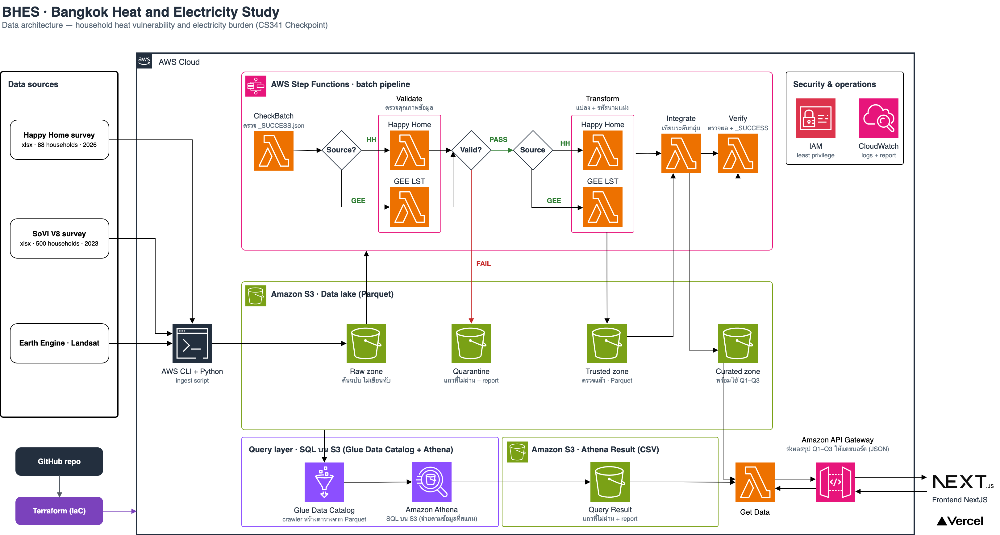

# CS341 Bangkok Heat & Electricity Study

โครงงานวิศวกรรมข้อมูลที่ศึกษาผลกระทบจากความร้อนและภาระค่าไฟของ **88 ครัวเรือนจาก 2 ชุมชนริมคลองเปรมประชากร เขตหลักสี่** ทีมใช้ AWS ตรวจและประมวลผลแบบสำรวจ Happy Home ก่อนนำผลจาก Athena มาแสดงบนแดชบอร์ด Next.js

[เปิดแดชบอร์ด](https://frontend-kappa-topaz-59.vercel.app) · [รันแดชบอร์ด](#รันแดชบอร์ด) · [สถาปัตยกรรม](architecture/README.md) · [คู่มือ AWS และการรันซ้ำ](Docs/Runbook.md) · [ไฟล์ SQL และภาพสำหรับนำเสนอ](reports/athena-exports/)

## ผลสำรวจ Q1–Q3

| คำถาม | สิ่งที่พบในกลุ่มตัวอย่าง |
| --- | --- |
| **Q1** ลักษณะบ้านสัมพันธ์กับผลกระทบจากความร้อนอย่างไร | บ้านผนังไม้รายงานผลกระทบสูง **45.9%** (17/37) เทียบกับ **21.6%** (11/51) ในบ้านผนังวัสดุอื่น ส่วนลักษณะบ้านหลายข้อยังสรุปได้จำกัด |
| **Q2** ภาระค่าไฟต่างกันอย่างไรตามรายได้และการมีแอร์ | บ้านที่มีภาระสูงคิดเป็น **79.4%**, **34.8%** และ **0%** ในกลุ่มรายได้ไม่เกิน 10,000 บาท, 10,001–20,000 บาท และมากกว่า 20,000 บาทต่อเดือน ตามลำดับ เมื่อรวมทุกช่วงรายได้ บ้านไม่มีแอร์อยู่ที่ **40.5%** เทียบกับ **39.1%** ในบ้านมีแอร์ |
| **Q3** ครัวเรือนกลุ่มไหนควรได้รับความช่วยเหลือก่อน | เกณฑ์บนแดชบอร์ดจัด **32 บ้าน** อยู่ในกลุ่มช่วยก่อน **45 บ้าน** อยู่ในกลุ่มเฝ้าระวัง และ **11 บ้าน** มีระดับการเผชิญความร้อนต่ำกว่าเกณฑ์ ข้อมูลเรื่องปัจจัยที่เอื้อต่อการปรับปรุงบ้านยังมีจำกัด |

**วิธีอ่านผล** ภาระค่าไฟคำนวณจากค่าไฟหน้าร้อนเทียบกับรายได้ต่อเดือน แบบสำรวจบันทึกเป็นช่วง จึงนับว่า **ภาระสูง** เมื่อขอบล่างของสัดส่วนถึง 10% ผลเปรียบเทียบอธิบายความสัมพันธ์ในกลุ่มตัวอย่าง เช่น สัดส่วนภาระสูงของบ้านมีแอร์กับไม่มีแอร์ใกล้กันเมื่อรวมทุกช่วงรายได้ ขณะที่สัดส่วนบ้านที่มีแอร์ต่างกันตามรายได้

รายงานผลวิเคราะห์ฉบับแรกใช้คะแนนรุ่น D7 สำหรับ Q3 ส่วนแดชบอร์ดใช้ D27/D28 ซึ่งรวมอุณหภูมิพื้นผิวรายครัวเรือนเมื่อมีข้อมูล

**ตรวจวิธีคำนวณได้จากหน้าเว็บ** ท้ายหน้า Q1, Q2 และ Q3 มีส่วน "วิธีคำนวณและที่มาของตัวเลข" บอกตารางและคอลัมน์ที่ใช้ แผนภาพเส้นทางจากข้อในแบบสอบถามถึงผลบนหน้า สูตร ตัวอย่างคิดเลขกับบ้านสมมติ และป้ายบอกว่าเกณฑ์ใดมีงานอ้างอิง (IPCC, OECD/JRC, ACEEE) หรือทีมกำหนดเองพร้อมรหัสการตัดสินใจ D

การเปรียบเทียบการระบายอากาศใน Q1 บนแดชบอร์ดเทียบบ้านที่ระบายอากาศไม่ดีกับบ้านอื่นทั้งหมด ได้ 43.5% เทียบกับ 19.0% (p = 0.021) ถ้าเทียบกับบ้านที่ระบายอากาศดีอย่างเดียวตาม [รายงานผลวิเคราะห์](reports/q1_q3_findings.md) จะได้ 43.5% เทียบกับ 21.7% (p = 0.111)

## ข้อมูลที่ใช้

| แหล่งข้อมูล | บทบาทในโครงการ |
| --- | --- |
| **Happy Home / ThaiCI** · ก.ค. 2026 | แบบสำรวจหลักสำหรับ Q1–Q3 ครอบคลุมลักษณะบ้าน ผลกระทบจากความร้อน รายได้ ค่าไฟ และอุปกรณ์ทำความเย็น |
| **SoVI V8** · 2023 | สำรวจ 500 ครัวเรือนใน 17 ชุมชน ใช้เป็นบริบทระดับกลุ่มสำหรับ Q3 ข้อมูลต่างปีและต่างพื้นที่ จึงเปรียบเทียบได้ในระดับกลุ่ม |
| **Landsat 8/9 ผ่าน Earth Engine** | คำนวณอุณหภูมิพื้นผิว (LST) ระดับชุมชนและรายครัวเรือน เสริมการประเมินการเผชิญความร้อนใน Q3 |

ข้อมูลสำรวจดิบเก็บใน `data/` หรือ S3 ที่จำกัดสิทธิ์ โดย `data/` อยู่ใน `.gitignore` ส่วนผลที่เผยแพร่เป็นข้อมูลสรุประดับกลุ่มและปกปิดค่าที่อาจเผยจำนวนกลุ่มย่อย 1–4 ครัวเรือน

[พจนานุกรมข้อมูล](reports/data_dictionary.md) · [การเปรียบเทียบ Happy Home กับ SoVI](reports/integration_feasibility.md) · [ข้อมูลจาก Earth Engine](reports/gee_lst_pipeline.md)

## ระบบทำงานอย่างไร

[](architecture/bhes_architecture_v2.drawio.svg)

1. **รับเข้า** สคริปต์ Ingest ส่งไฟล์เข้า S3 Raw และกำหนด `batch_id` จากเนื้อหาไฟล์
2. **แปลงและตรวจ** Step Functions เรียก Lambda ตามลำดับ CheckBatch → Validate → Transform → Integrate → Verify ข้อมูลที่ไม่ผ่าน Validate ไปที่ Quarantine ส่วน Verify ตรวจข้อมูลชุดที่จะเผยแพร่ก่อนเขียนลง Curated
3. **วิเคราะห์** Glue ลงทะเบียนตาราง Parquet ใน Data Catalog แล้ว Athena รวมผลด้วย SQL
4. **แสดงผล** Next.js เรียก API Gateway จากฝั่งเซิร์ฟเวอร์ด้วย AWS IAM จากนั้น Dashboard Lambda ส่งข้อมูลสรุปกลับมาให้หน้าเว็บ

[รายละเอียดสถาปัตยกรรม](architecture/README.md) · [กฎตรวจและแปลงข้อมูล](reports/validation_rules.md)

## รันแดชบอร์ด

### ดูผลจากไฟล์ที่มีใน repo

เปิด [`dashboard/index.html`](dashboard/index.html) ในเบราว์เซอร์ได้เลย หน้านี้สร้างจาก CSV ผล Athena ที่บันทึกไว้ เหมาะกับการเปิดสาธิตโดยไม่ต้องตั้งค่า AWS

### รัน Next.js ด้วยข้อมูล AWS

ใช้ Node.js **20.9 ขึ้นไป** และ AWS profile ที่มีสิทธิ์ `execute-api:Invoke` กับเส้นทางที่ต้องการ จากโฟลเดอร์รากของโปรเจกต์ให้รัน

```bash
cd frontend
npm ci
test -f .env.local || cp .env.example .env.local
```

ตั้ง `Q3_API_URL` ใน `frontend/.env.local` ให้เป็น URL ที่ลงท้ายด้วย `/dashboard/q3` และตั้ง `AWS_PROFILE` ให้ตรงกับโปรไฟล์ในเครื่อง หาก Q1–Q3 ใช้ API Gateway เดียวกัน ระบบจะหา URL ของ Q1 และ Q2 จาก URL นี้ได้ กรณีใช้คนละ Gateway ให้ตั้ง `Q1_API_URL` หรือ `Q2_API_URL` เพิ่ม

```bash
npm run dev
```

เปิด **http://localhost:3000** แล้วเลือกหน้า `/q1`, `/q2` หรือ `/q3` หน้า Q2 และ Q3 แสดงตารางรายครัวเรือนทั้งบนเครื่องและบน Vercel โดยต้องมีสิทธิ์เรียก endpoint `/households` ส่วนวิธีคำนวณท้ายแต่ละหน้าเป็นเนื้อหาคงที่ในโค้ด จึงแสดงได้แม้ยังไม่ได้ตั้งค่า API

[หา URL จาก Terraform, ตั้งสิทธิ์ และแก้ปัญหาการเชื่อมต่อ](Docs/Runbook.md#เชื่อมแดชบอร์ดกับ-aws)

## หาโค้ดและเอกสาร

| ตำแหน่ง | สิ่งที่อยู่ข้างใน |
| --- | --- |
| [`frontend/`](frontend/) · [`dashboard/`](dashboard/) | Next.js ที่อ่านข้อมูล AWS และแดชบอร์ด HTML ที่สร้างจาก CSV ส่วนวิธีคำนวณอยู่ใน `frontend/app/q*/method.tsx` |
| [`services/dashboard_query/`](services/dashboard_query/) | API handler, SQL ของแดชบอร์ด และการอ่านคอลัมน์รายครัวเรือนจาก S3 |
| [`scripts/`](scripts/) · [`lambdas/`](lambdas/) | Ingest, ตรวจ codebook, ดึง LST และประมวลผลแต่ละ batch ตาม [schema contracts](lambdas/common/contracts/) |
| [`infra/terraform/`](infra/terraform/) | ทรัพยากร AWS, IAM, Step Functions และ API Gateway |
| [`analytics/`](analytics/) · [`analytics/results/`](analytics/results/) | SQL วิจัย, CSV ผลลัพธ์ และสคริปต์ตรวจเทียบผล |
| [`tests/`](tests/) | เทสต์ pipeline, schema และการคำนวณคะแนน |

[วิธีทดสอบและรัน pipeline ซ้ำ](Docs/Runbook.md) · [ข้อเสนอโครงงาน](Docs/Copy%20of%20CS341_Proposal_Template.docx.pdf) · [แผนแก้ข้อเสนอ](Docs/Proposal_Revision_Plan.md) · [บันทึกการใช้ AI](Docs/AI_Usage.md)

## สมาชิกทีม

| ชื่อ | รหัสนักศึกษา |
| --- | --- |
| นาย ศุภณัฐ จันทร์เลข | 6709616897 |
| นาย จักรพงษ์ ปักษา | 6709540055 |
| นาย พรินทาน หนุนชู | 6709616673 |
| นาย บริวัฒน์ สงนุ้ย | 6709681107 |

ทีมทำงานบน feature branch แล้วเปิด Pull Request เข้า `dev` ก่อนรวมเข้า `main` งานและผลตรวจติดตามได้จาก [GitHub Issues](https://github.com/Printan00/CS341-Bangkok-Heat-And-Electricity-Study/issues) และ [Pull Requests](https://github.com/Printan00/CS341-Bangkok-Heat-And-Electricity-Study/pulls)
