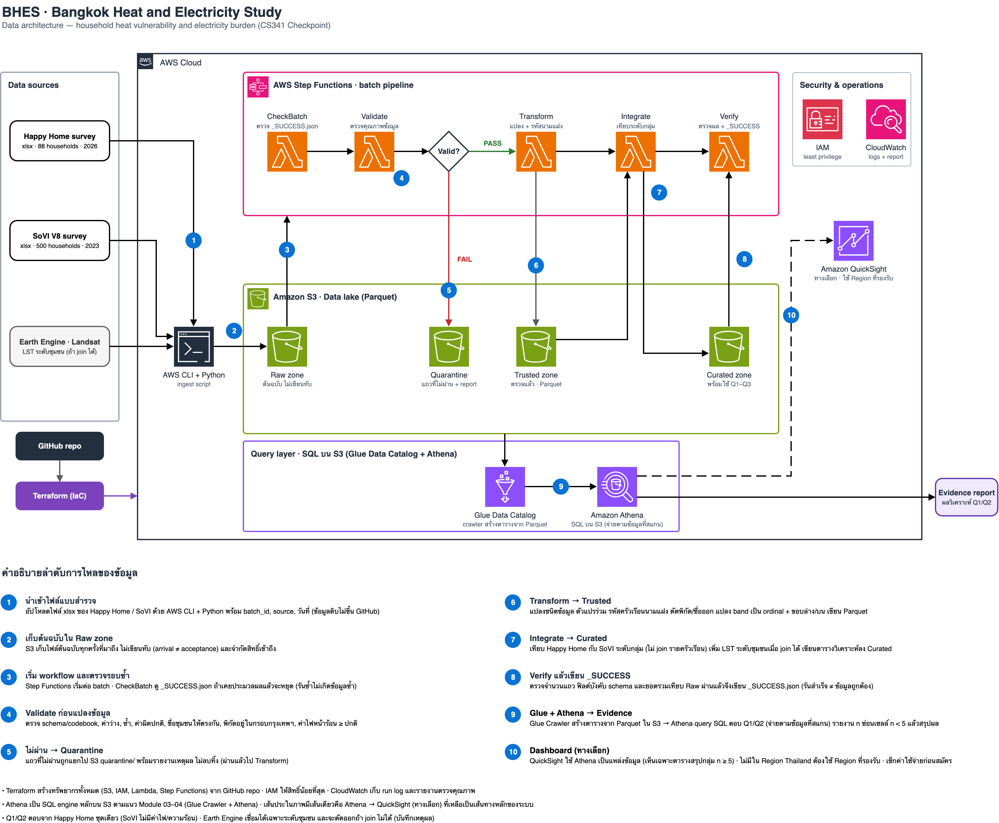

# CS341-project
## 1. Project Overview
เป็นโครงงานระบบวิศวกรรมข้อมูลเพื่อศึกษาความเปราะบางต่อความร้อนในเมือง และภาระค่าไฟฟ้าของครัวเรือนในกรุงเทพมหานคร
โครงงานมุ่งศึกษาความสัมพันธ์ระหว่างลักษณะที่อยู่อาศัย สภาพแวดล้อม รายได้ ผลกระทบจากความร้อน และค่าใช้จ่ายด้านพลังงาน เพื่อช่วยระบุกลุ่มครัวเรือนที่อาจต้องการการสนับสนุนเป็นลำดับแรก
โครงการนี้มุ่งพัฒนา Data Pipeline สำหรับรวบรวม ตรวจสอบคุณภาพ จัดเก็บ และวิเคราะห์ข้อมูลจริง โดยไม่สรุปความสัมพันธ์เชิงเหตุและผลเกินกว่าหลักฐานที่มี

## 2. Problem Statement
ครัวเรือนในพื้นที่เมืองได้รับผลกระทบจากความร้อนไม่เท่ากัน เนื่องจากปัจจัยหลายด้าน เช่น
- ลักษณะบ้าน วัสดุหลังคา และการระบายอากาศ
- ร่มเงาและสภาพแวดล้อมรอบบ้าน
- รายได้และความสามารถในการปรับตัว
- การเข้าถึงอุปกรณ์ทำความเย็น
- ค่าใช้จ่ายด้านพลังงาน

## 3. Research Questions
### Q1 : Urban Heat Vulnerability
ลักษณะบ้าน เช่น วัสดุหลังคา ร่มเงา และการระบายอากาศ สัมพันธ์กับผลกระทบจากความร้อนอย่างไร และครัวเรือนกลุ่มใดมีข้อจำกัดในการรับมือมากที่สุด?

### Q2 : Heat & Energy Burden
ภาระค่าไฟเมื่อเทียบกับรายได้แตกต่างกันอย่างไรระหว่างกลุ่มรายได้ และระหว่างครัวเรือนที่เข้าถึงการทำความเย็นต่างกัน?

### Q3 : Household Support Prioritization
เมื่อพิจารณาผลกระทบจากความร้อน ภาระค่าไฟ และข้อจำกัดในการปรับปรุงบ้าน ครัวเรือนกลุ่มใดอาจควรได้รับการสนับสนุนก่อน?  และปัจจัยใดทําให้บางครัวเรือนปรับปรุงบ้านได้ ขณะที
บางครัวเรือนทําไม่ได้?

## 4. Data Sources
โครงการวางแผนใช้ข้อมูลสำรวจครัวเรือน 2 ชุดเป็นแหล่งข้อมูลหลัก

### Social Vulnerability Survey (SoVI V8)
- ปีที่สำรวจ: 2023
- 500 ครัวเรือน จาก 17 ชุมชนในกรุงเทพฯ และปริมณฑล
- ข้อมูลรายได้ รายจ่าย ลักษณะบ้าน และความสามารถในการปรับตัว

### Happy Home / Nature-based Solutions Survey
- ปีที่สำรวจ: 2026
- 88 ครัวเรือน (ประกาศระบุ ~81) จาก 2 ชุมชนริมคลองเปรมประชากร เขตหลักสี่ สัมภาษณ์เดือนกรกฎาคม 2026
- ข้อมูลลักษณะบ้าน ผลกระทบจากความร้อน การใช้พลังงาน และแนวทางปรับปรุงสภาพแวดล้อม

### Optional Data Sources
- Landsat / GIS (Earth Engine) ใช้เป็นตัวแปรเสริมระดับชุมชนของ Happy Home เท่านั้น (`scripts/gee_lst.py`, ดู `reports/integration_feasibility.md`) จะตัดออกถ้าความต่างระหว่างชุมชนไม่มีนัย
- Climate and Heat Hazard Open Data

> ข้อมูลสำรวจดิบ **ไม่อยู่ใน repo นี้** (repo เป็น public และข้อมูลไม่ผ่าน k-anonymity) เก็บในโฟลเดอร์ `data/` ในเครื่องเท่านั้น ซึ่งถูกตั้งไว้ใน `.gitignore` สมาชิกรับไฟล์จากช่องทางของวิชา

## 5. Data Architecture
สถาปัตยกรรมข้อมูลฉบับ Checkpoint (คลิกที่ภาพเพื่อดูขนาดเต็ม ไฟล์ต้นฉบับแก้ไขได้ใน draw.io: [architecture/bhes_architecture_v2.drawio.svg](architecture/bhes_architecture_v2.drawio.svg))

[](architecture/bhes_architecture_v2.png)

### เส้นทางของข้อมูล (อ่านตามเลขในภาพ)
`แบบสำรวจ (xlsx)` → **Ingest** → **Raw** → **Validate** → (ไม่ผ่าน → **Quarantine**) → **Transform** → **Trusted** → **Integrate** → **Curated** → **Verify** → **Glue Data Catalog + Athena (SQL)** → Evidence report (และ QuickSight เป็นทางเลือก)

| ส่วน | บริการ | หน้าที่ |
|---|---|---|
| Ingest | AWS CLI + Python | อัปโหลดไฟล์เข้า S3 พร้อม batch_id, source, วันที่ ไม่เขียนทับต้นฉบับ |
| Orchestration | AWS Step Functions + Lambda | CheckBatch → Validate → Transform → Integrate → Verify ต่อ batch |
| Raw (S3) | Amazon S3 | เก็บไฟล์ต้นฉบับทุกครั้งที่มาถึง จำกัดสิทธิ์เข้าถึง (arrival ≠ acceptance) |
| Quarantine (S3) | Amazon S3 | แถวที่ไม่ผ่าน Validate พร้อมรายงานเหตุผล ไม่ลบทิ้ง |
| Trusted (S3, Parquet) | Amazon S3 | ข้อมูลที่ผ่านการตรวจแล้ว รหัสครัวเรือนนามแฝง ตัดพิกัด/ชื่อออก |
| Curated (S3, Parquet) | Amazon S3 | ตารางวิเคราะห์ตอบ Q1–Q3 เทียบระดับกลุ่ม พร้อม lineage (batch_id, source) |
| Query layer | AWS Glue (Crawler + Data Catalog) + Amazon Athena | สร้างตารางจาก Parquet ใน S3 แล้ว query ด้วย SQL (ตาม Module 03–04) จ่ายตามข้อมูลที่สแกน |
| Dashboard (ทางเลือก) | Amazon QuickSight | ใช้ Athena เป็นแหล่งข้อมูล เห็นเฉพาะตารางสรุปกลุ่ม n ≥ 5 (เส้นประในภาพ) |
| Security & operations | IAM, CloudWatch | สิทธิ์น้อยที่สุด, run log และรายงานตรวจคุณภาพ |
| IaC | Terraform (จาก GitHub repo) | สร้างทรัพยากรทั้งหมดให้รันซ้ำได้ |

### หลักการออกแบบ
- **Validate ก่อน Transform:** ข้อมูลที่ยังไม่ผ่านการตรวจจะไม่ถูกแปลง
- **รันซ้ำได้:** CheckBatch ดู `_SUCCESS.json` ถ้า batch นี้ประมวลผลแล้วจะหยุด ไม่เกิดข้อมูลซ้ำ
- **รันสำเร็จ ≠ ข้อมูลถูกต้อง:** ขั้น Verify ตรวจจำนวนแถว ฟิลด์บังคับ schema และยอดรวมก่อนเขียน `_SUCCESS.json`
- **ความเป็นส่วนตัว:** repo เป็น public จึงไม่มีข้อมูลดิบบน GitHub และรายงานซ่อนเซลล์ n < 5
- **ไม่ join สองชุดสำรวจรายครัวเรือน:** ต่างปี ต่างพื้นที่ ต่างชั้นรายได้ จึงเทียบระดับกลุ่ม

### ข้อควรรู้เรื่อง AWS
- ยังไม่ได้ล็อก Region: Thailand (`ap-southeast-7`) มี S3, Lambda, Step Functions, Glue, Athena และ CloudWatch แต่ **ไม่มี QuickSight** ถ้าจะใช้ dashboard ต้องใช้ Region ที่รองรับ (เช่น Singapore) ทุกคนในทีมต้องตั้ง Region เดียวกัน
- Athena และ QuickSight มีค่าใช้จ่าย ควรตั้ง Budget alert และเช็กราคาก่อนใช้
- ไม่ใช้ root access key ในงานประจำ และห้ามเก็บ access key หรือ `*.tfstate` ใน repo

## 6. ข้อค้นพบจากการตรวจข้อมูล
ผลตรวจ codebook (การ์ด #14) รายละเอียดเต็มอยู่ใน [reports/data_dictionary.md](reports/data_dictionary.md)

- **Q1/Q2 ตอบจาก Happy Home ชุดเดียว** SoVI ไม่มีค่าไฟ เครื่องใช้ไฟฟ้า หรือตัวแปรความร้อน (ครอบคลุมน้ำท่วมและภัยแล้ง) จึงใช้เป็นบริบทของ Q3
- **ความร้อนแยกจากน้ำท่วมได้ในโครงสร้างแบบสอบถาม** แต่คำตอบของสองภัยสอดคล้องกันมาก แยกเชิงสถิติได้ยาก
- **รายได้และค่าไฟเป็นช่วง (band) รายเดือน** จึงรายงานภาระค่าไฟเป็นช่วงต่ำสุด–สูงสุด ไม่ใช่ค่าเดียว
- Happy Home มี **88 แถว** (ไม่ใช่ ~81) ชื่อชุมชนมี 16 รูปแบบ (จริง 2 ชุมชน) ต้อง normalise
- Happy Home **มีพิกัดครัวเรือน** (ปัด ≈100 ม.) ต้องตัดออกก่อนเข้า Trusted และห้ามเผยแพร่
- Q1 ตัวแปรอธิบายแปรผันน้อย (เช่น ไม่มีฉนวน 81/88) ผลอาจออกมาเป็น "ยังไม่เพียงพอ" ซึ่งยอมรับได้ตามสเปก

## 7. โครงสร้าง repo
```
README.md                      ภาพรวมโครงการ (ไฟล์นี้)
architecture/                  Architecture diagram (.drawio.svg ต้นฉบับ + .png) และวิธีแก้ไข
reports/                       data dictionary และรายการตัวแปร (เฉพาะค่ารวม ไม่มีข้อมูลรายแถว)
analytics/                     SQL บน Athena ตอบ Q1–Q3 (q1_/q2_/q3_*.sql), ผลลัพธ์ที่ซ่อน n<5 (results/), สคริปต์ตรวจซ้ำกับไฟล์ดิบ (recheck_local.py, compare_athena_local.py) และ significance.py
reports/q1_q3_findings.md      สรุปผลวิเคราะห์ Q1–Q3 สนับสนุน/ขัดแย้ง/ยังไม่เพียงพอ พร้อมข้อจำกัด
scripts/profile_codebook.py    สคริปต์ตรวจ codebook รันซ้ำได้
scripts/gee_lst.py             LST ระดับชุมชนจาก Landsat ผ่าน Earth Engine (ทางเลือก ต้อง authenticate)
scripts/ingest.py              นำไฟล์จาก data/ เข้า S3 raw/ พร้อม metadata (รันซ้ำไม่เกิดข้อมูลซ้ำ)
infra/terraform/               Terraform ของทรัพยากร AWS ทั้งหมด (S3, IAM, Lambda, Step Functions, Glue, Athena)
lambdas/<step>/handler.py      โค้ด Lambda แต่ละขั้น (check_batch, validate, transform, integrate, verify)
lambdas/common/                โค้ดที่ทุกขั้นใช้ร่วม + contracts/ (กฎ, ชื่อคอลัมน์จริง, schema ของ trusted/curated)
tests/                         เทสต์อัตโนมัติของ pipeline (pytest)
Docs/                          Proposal และแผนแก้ไข (ไฟล์อื่นใน Docs/ ไม่ track)
data/                          ข้อมูลสำรวจดิบ (ในเครื่องเท่านั้น อยู่ใน .gitignore)
```

## 8. วิธีรันสคริปต์ตรวจ codebook
ต้องวางไฟล์ข้อมูลที่ได้รับจากอาจารย์ไว้ที่ `data/` ก่อน
```bash
python -m venv .venv && .venv/bin/pip install -r scripts/requirements.txt
.venv/bin/python scripts/profile_codebook.py --data-dir data --out reports
```
ผลลัพธ์เป็นค่ารวมเท่านั้น (เซลล์ n < 5 แสดงเป็น `<5` ไม่มีพิกัดหรือรหัสครัวเรือน)

## 8.1 Deploy / Destroy (Terraform)
Region: `ap-southeast-1` (Singapore) ต้องตั้ง AWS CLI credentials ก่อน

| Bucket | ใช้ทำอะไร |
|---|---|
| `bhes-lake-<account_id>` | data lake: `raw/`, `quarantine/`, `trusted/`, `curated/` (versioning เปิด) |
| `bhes-athena-results-<account_id>` | ผลลัพธ์ query ของ Athena |
| `bhes-tfstate-<account_id>` | Terraform state (สร้างด้วยมือครั้งเดียว ไม่อยู่ใน Terraform) |

ทุก bucket เปิด Block Public Access ครบ 4 ข้อ

| IAM | ใช้โดย | สิทธิ์ |
|---|---|---|
| `bhes-lambda` (role) | Lambda ทุกขั้น | อ่าน `raw/` อย่างเดียว (เขียน/ลบไม่ได้), อ่าน/เขียน `quarantine/` `trusted/` `curated/`, CloudWatch Logs |
| `bhes-sfn` (role) | Step Functions | เรียก Lambda ชื่อ `bhes-*` |
| `bhes-glue-crawler` (role) | Glue Crawler | อ่าน `curated/` อย่างเดียว |
| `bhes-athena-query` (policy) | ผู้ใช้ / QuickSight ที่จะ query | Athena workgroup `bhes-*`, อ่าน Glue catalog + `curated/`, เขียนผลลง athena-results bucket |

| Pipeline | ชื่อ |
|---|---|
| Lambda (1 ตัวต่อขั้น, log อยู่ CloudWatch `/aws/lambda/<ชื่อ>`) | `bhes-check-batch`, `bhes-validate`, `bhes-transform`, `bhes-integrate`, `bhes-verify` |
| Step Functions | `bhes-pipeline`: CheckBatch → AlreadyDone? → Validate → Valid? → Transform → Integrate → Verify |
| Glue | database `bhes`, crawler `bhes-curated` (1 โฟลเดอร์ใต้ `curated/` = 1 ตาราง) |
| Athena | workgroup `bhes-wg` (จำกัด 1 GB ต่อ query) |

**ครั้งแรกเท่านั้น: สร้าง bucket สำหรับ state** (ทำแล้วสำหรับ account ของทีม)
```bash
B=bhes-tfstate-<account_id>; R=ap-southeast-1
aws s3api create-bucket --bucket $B --region $R --create-bucket-configuration LocationConstraint=$R
aws s3api put-bucket-versioning --bucket $B --versioning-configuration Status=Enabled
aws s3api put-public-access-block --bucket $B --public-access-block-configuration BlockPublicAcls=true,IgnorePublicAcls=true,BlockPublicPolicy=true,RestrictPublicBuckets=true
```

**Deploy**
```bash
terraform -chdir=infra/terraform init
terraform -chdir=infra/terraform plan
terraform -chdir=infra/terraform apply
```

**Ingest ข้อมูลเข้า Raw** (วางไฟล์ xlsx ใน `data/` ก่อน) รันซ้ำได้ ไฟล์เดิมจะ SKIP ไม่ซ้ำ ไม่เขียนทับ
```bash
pip install -r scripts/requirements.txt
python scripts/ingest.py --bucket $(terraform -chdir=infra/terraform output -raw lake_bucket)
```
ไฟล์ขึ้น `incoming/` ก่อน แล้ว copy เข้า `raw/<source>/<batch_id>/` พร้อม metadata (`batch_id`, `source`, `ingested_at`, `sha256`) และ `_manifest.json` (log การนำเข้า) จากนั้นลบออกจาก `incoming/`
`batch_id` = `<source>-<sha256 12 ตัวแรก>` ไฟล์เนื้อหาเดิมได้ `batch_id` เดิมเสมอ

**รัน pipeline 1 batch / crawl / query** (ใช้ `batch_id` ที่ ingest พิมพ์ออกมา)
```bash
export AWS_DEFAULT_REGION=ap-southeast-1
aws stepfunctions start-execution --state-machine-arn arn:aws:states:ap-southeast-1:<account_id>:stateMachine:bhes-pipeline --input '{"batch_id":"happy_home-26cba344f87c"}'
aws glue start-crawler --name bhes-curated
aws athena start-query-execution --work-group bhes-wg --query-execution-context Database=bhes --query-string 'SELECT ...'
```
ทดสอบว่า workflow หยุดที่ขั้นที่ล้มเหลว: ใส่ `"fail_at":"transform"` ใน input (ใช้ได้ทุกขั้น) ต้อง ingest ไฟล์ก่อน ไม่อย่างนั้นจะหยุดที่ Validate

ผลลัพธ์ของแต่ละ batch (กฎและเหตุผลอยู่ใน [reports/validation_rules.md](reports/validation_rules.md)):

| ขั้น | เขียนที่ |
|---|---|
| Validate | `quarantine/<source>/<batch_id>/` : `dq_report.json` (ผ่าน/ไม่ผ่านกี่แถว เพราะกฎไหน), `violations.csv`, `rows.jsonl` (แถวที่ถูกแยก), `manifest.json` |
| Transform | `trusted/happy_home/batch_id=<batch_id>/part-0.parquet` (ไม่มีพิกัด ชื่อ หรือรหัสผู้สัมภาษณ์) |
| Integrate | `curated/_pipeline/staging/<batch_id>/happy_home_household.parquet` (risk score T13) |
| Verify | ผ่าน: `curated/happy_home_household/part-0.parquet` + `curated/_pipeline/success/<batch_id>/_SUCCESS.json`; ไม่ผ่าน: workflow ล้มที่ Verify พร้อมเหตุผล |

รัน batch เดิมซ้ำ: CheckBatch เจอ `_SUCCESS.json` ของ batch นั้น จึงไปที่ SkipDuplicate ไม่เขียนอะไรซ้ำ (batch ที่ล้มกลางทางไม่มีไฟล์นี้ จึงรันใหม่ได้ ทุกขั้นเขียนทับ key เดิม ไม่เกิดข้อมูลซ้ำ)
แก้กฎหรือเกณฑ์ใน `lambdas/common/contracts/` แล้ว (และ `terraform apply` แล้ว) ให้รันไฟล์เดิมด้วย `--input '{"batch_id":"<batch_id>","force":true}'` ไม่อย่างนั้นจะถูกข้าม เพราะไฟล์เดิมได้ `batch_id` เดิม
ตอนนี้มีกฎตรวจเฉพาะ Happy Home: batch ของ SoVI จะหยุดที่ Validate (`valid = false`) พร้อมเหตุผลใน `dq_report.json`
Transform, Integrate และ Verify ใช้ pyarrow จาก Lambda layer ของ AWS (AWS SDK for pandas) ส่วน Validate ใช้ Python standard library อย่างเดียว

**Destroy** bucket ต้องว่างก่อน (ไม่ได้เปิด `force_destroy` เพื่อกันข้อมูลหาย) lake bucket มี versioning จึงต้องลบทุก version ออกด้วย (ทำได้ใน S3 console ด้วยปุ่ม Empty)
```bash
terraform -chdir=infra/terraform destroy
```

## 8.2 เทสต์อัตโนมัติ (#22)
```bash
pip install -r tests/requirements.txt
python -m pytest tests                                  # ข้อมูลสังเคราะห์ ไม่ต้องมีไฟล์จริง
BHES_SAMPLE_DIR=<โฟลเดอร์ไฟล์สำรวจ> python -m pytest tests   # เพิ่มเทสต์กับไฟล์จริง (ตรวจตัวเลขในสเปก D1–D7)
```
เทสต์รันทุกขั้น Validate → Transform → Integrate → Verify ผ่าน S3 จำลองในหน่วยความจำ มีทั้งกรณีผ่าน (เขียน `_SUCCESS.json`) และกรณีไม่ผ่าน (แถวหาย, มีคอลัมน์พิกัดเกินมา, จำนวนแถว raw ไม่ตรง: Verify ล้มและไม่ publish อะไร)

ผลล่าสุด (12 พ.ย. 2026, Python 3.14, pyarrow 26):
```
python -m pytest tests                                  → 58 passed, 5 skipped (5 = เทสต์ไฟล์จริง)
BHES_SAMPLE_DIR=... python -m pytest tests              → 63 passed
```
ผลกับไฟล์จริง: Happy Home 88 แถว ผ่าน 88 ถูกแยก 0; ภาระค่าไฟ high 35 / possibly_high 31 / low 22; ตัวเลขตรงกับตาราง "Threshold และเหตุผล" ในสเปกทุกข้อ

**ทดสอบบน AWS จริง** (12 พ.ย. 2026, `ap-southeast-1`, หลัง `terraform apply`):

| การรัน | ผล |
|---|---|
| `{"batch_id":"happy_home-26cba344f87c"}` | SUCCEEDED: CheckBatch → Validate → Transform → Integrate → Verify; ผ่าน 88 ถูกแยก 0; trusted/curated ตรงกับผลในเครื่องทุกช่อง |
| batch เดิมซ้ำ | SUCCEEDED ที่ SkipDuplicate (ไม่เขียนซ้ำ) |
| batch เดิม + `"force":true` | SUCCEEDED ผ่านทุกขั้นอีกรอบ ไฟล์ curated เหมือนเดิมทุก byte ไม่มีไฟล์ซ้ำ |
| `{"batch_id":"sovi-7fb4858da401"}` | FAILED ที่ ValidationFailed (ยังไม่มีกฎของ SoVI) |
| `"fail_at":"check_batch"` | FAILED ที่ CheckBatch ตามที่สั่ง |
| Glue crawler + Athena | ได้ตาราง `happy_home_household` 1 ตาราง (38 คอลัมน์, ไม่รวม `_pipeline/`); `count(*)` = 88, burden_class 35 / 31 / 22, heat_impact_level 15 / 45 / 28 |

## 9. สถานะและการทำงาน
| สถานะ | รายการ |
|---|---|
| ทำแล้ว | ข้อมูลสำรวจพร้อม (#13), ตรวจ codebook และ data dictionary (#14), Architecture diagram (#15), Terraform (#16, #17), Ingestion (#18) |
| ทำแล้ว รอรีวิว (ทดสอบบน AWS แล้ว) | Validate + Quarantine (#19), Transform → Trusted (#20), CheckBatch / Idempotency (#21), Verify (#22) |
| กำลังวางแผน | ตรวจการเชื่อม GEE (#23), นิยามตัวชี้วัด + SQL บน Athena (#24), QuickSight (#33, ทางเลือก), README และบันทึกการใช้ AI (#27), เตรียม Demo (#28) |

- ภาพ Architecture เป็นดีไซน์เป้าหมายของ Checkpoint ถ้าตอนสร้างจริงต่างจากภาพ ให้แก้ภาพตาม
- งานติดตามใน GitHub Issues และ Project board ของ repo
- Git flow: สร้าง branch → Pull Request เข้า `dev` → `dev` → `main`
