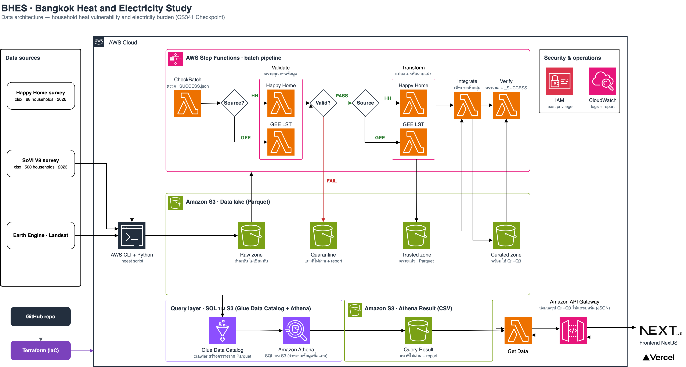

# สถาปัตยกรรม BHES

ระบบแบ่งงานเป็นสองส่วน ฝั่ง pipeline รับและตรวจข้อมูลทีละ batch ส่วนฝั่งแดชบอร์ดอ่านตารางที่ผ่าน Verify แล้ว

[เปิดไฟล์ที่แก้ไขได้ใน draw.io](bhes_architecture_v2.drawio.svg)

## Pipeline และ Data Lake

AWS Step Functions เรียก Lambda แต่ละขั้นตาม [state machine](../infra/terraform/stepfunctions.tf) ข้อมูลแต่ละ batch มีรหัสจากแหล่งข้อมูลและ SHA-256 ของไฟล์ ทำให้ตรวจได้ว่าไฟล์เดิมเคยผ่านงานแล้วหรือยัง

| ขั้น | ทำอะไร | ผลลัพธ์ |
| --- | --- | --- |
| Ingest | เก็บไฟล์ต้นฉบับพร้อม metadata และ manifest | `raw/<source>/<batch_id>/` |
| CheckBatch | ตรวจ `_SUCCESS.json` ของ batch เดิม | ข้าม batch ที่สำเร็จแล้ว เว้นแต่ขอรันด้วย `force` |
| Validate | ตรวจ schema คำตอบ แถวซ้ำ และข้อกำหนดของแหล่งข้อมูล | `quarantine/<source>/<batch_id>/` เก็บรายงาน, manifest และแถวที่ถูกแยกตามกฎ |
| Transform | แปลงข้อมูลที่ผ่านเป็น Parquet และเลือกคอลัมน์ตาม contract | `trusted/<source>/batch_id=<batch_id>/part-0.parquet` |
| Integrate | เตรียมตารางวิเคราะห์และเชื่อม LST กับ Happy Home | `curated/_pipeline/staging/<batch_id>/<table>.parquet` |
| Verify | ตรวจ schema จำนวนแถว คีย์ ฟิลด์บังคับ และผลตามกฎ | `curated/<table>/part-0.parquet` และ `curated/_pipeline/success/<batch_id>/_SUCCESS.json` เมื่อผ่าน |

Glue crawler อ่าน `curated/` โดยข้าม `_pipeline/` เพื่อให้ Athena เห็นเฉพาะตารางที่เผยแพร่แล้ว

| ตาราง | ใช้กับงาน |
| --- | --- |
| [`happy_home_household`](../lambdas/common/contracts/curated_happy_home_household.json) | ตัวแปรจากแบบสำรวจ คะแนนผลกระทบจากความร้อน และ SQL วิจัยเดิม เป็นแหล่งหลักของ API Q1 |
| [`happy_home_risk`](../lambdas/common/contracts/curated_happy_home_risk.json) | คะแนนความเสี่ยงและ LST สำหรับ Q3 รวมถึง `income_group`, `burden_class` และ `has_aircon` สำหรับ Q2 |
| [`community_dim`](../lambdas/common/contracts/curated_community_dim.json) | LST ระดับชุมชน เชื่อมกับ Happy Home ผ่าน `community_key` |
| [`household_lst`](../lambdas/common/contracts/curated_household_lst.json) | LST ระดับครัวเรือน เชื่อมผ่านรหัสครัวเรือนนามแฝง |

SoVI ใช้เปรียบเทียบบริบทระดับกลุ่ม ขั้น Validate ของ pipeline รองรับ Happy Home และ LST สองระดับ ส่วน batch ของ SoVI จะหยุดที่ Validate เพราะยังไม่มีกฎของชุดนี้

## จาก Athena ถึงหน้าเว็บ

Next.js ลงนามคำขอด้วย AWS SigV4 จากฝั่งเซิร์ฟเวอร์ API Gateway ใช้ `AWS_IAM` ทุกเส้นทาง และ Dashboard Lambda เป็นผู้รัน SQL ใน Athena ผล query อยู่ใน S3 bucket ของ Athena ส่วนแถวที่ไม่ผ่านการตรวจและรายงานคุณภาพอยู่ใน Quarantine ของ data lake

| เส้นทาง | แหล่งข้อมูล | สิ่งที่ส่งกลับ |
| --- | --- | --- |
| `GET /dashboard/q1` | [SQL Q1](../services/dashboard_query/q1.sql) บน `happy_home_household` | ผลกระทบจากความร้อนตามลักษณะบ้านและกลุ่มเปรียบเทียบ |
| `GET /dashboard/q2` | [SQL Q2](../services/dashboard_query/q2.sql) บน `happy_home_risk` | จำนวนบ้านและระดับภาระค่าไฟ แยกตามรายได้ การมีแอร์ และทั้งสองปัจจัย |
| `GET /dashboard/q3` | [SQL Q3](../services/dashboard_query/q3.sql) บน `happy_home_risk` | จำนวนบ้านและคะแนนเฉลี่ยต่อกลุ่มตามเกณฑ์การเผชิญความร้อนและความเปราะบาง |
| `GET /dashboard/q2/households` และ `GET /dashboard/q3/households` | [ตัวอ่าน Parquet](../services/dashboard_query/households.py) ของ `happy_home_risk` ใน S3 | คอลัมน์รายครัวเรือนตาม allowlist ของแต่ละเส้นทาง หน้าเว็บเปิดตารางนี้เฉพาะ dev บนเครื่อง |

Terraform กำหนด S3, IAM, Lambda, CloudWatch Logs, Step Functions, Glue, Athena และ Gateway ไว้ใน [`infra/terraform/`](../infra/terraform/) ตัวอย่าง AWS CLI และวิธีตั้งค่าอยู่ใน [Runbook](../Docs/Runbook.md)

## อัปเดตแผนภาพ

หลังแก้ใน draw.io ให้ export SVG แบบแนบข้อมูล diagram และ export PNG ใหม่ แล้ว commit ทั้งสองไฟล์พร้อมกัน
