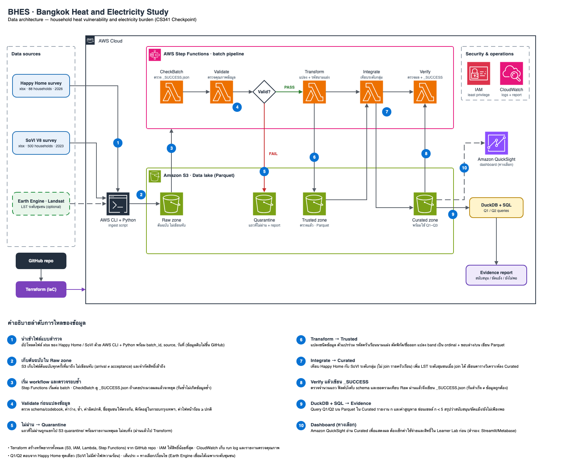

# Architecture diagram (Checkpoint)

| ไฟล์ | ใช้ทำอะไร |
|---|---|
| `bhes_architecture.drawio.svg` | **ไฟล์ต้นฉบับ** เปิดแก้ใน draw.io ได้ (https://app.diagrams.net → File → Open from → Device) และเปิดดูในเบราว์เซอร์ได้ |
| `bhes_architecture.png` | ภาพสำหรับแสดงใน README / ใส่สไลด์ (เรนเดอร์จากไฟล์ต้นฉบับ) |

วิธีอัปเดตภาพ: แก้ `bhes_architecture.drawio.svg` ใน draw.io แล้วบันทึกทับ จากนั้น export PNG ใหม่ (File → Export as → PNG) ทับ `bhes_architecture.png`

ไอคอน AWS ใช้ไลบรารี `mxgraph.aws4` ในตัว draw.io ส่วน GitHub, Terraform, DuckDB ฯลฯ เป็นกล่องข้อความ
